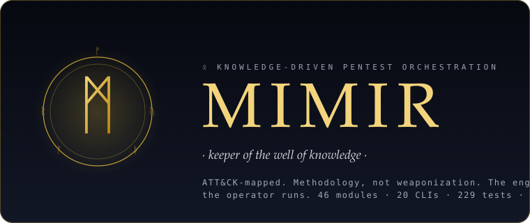

<p align="center">
  
</p>

<h1 align="center">Mimir</h1>

<p align="center">
  <b><i>Knowledge-driven pentest orchestration. The engine stages; the operator runs.</i></b>
</p>

<p align="center">
  Mimir plans and <b>stages</b> an authorised engagement end-to-end — scope, scan, assess,
  correlate, stage, report — then hands the operator a MITRE ATT&amp;CK-mapped runbook
  they execute by hand. The engine itself fires no exploits, operates no C2.
</p>

<p align="center">
  <a href="https://github.com/ShadowSlayer08/mimir/actions/workflows/ci.yml"></a>
  <a href="pyproject.toml"></a>
  <a href="docs/"></a>
  <a href="LICENSE"></a>
  <a href="docs/instructions.md"></a>
</p>

<p align="center">
  <sub>46 modules · 20 CLIs · 7 CI eval scenarios at 100% recall · zero payloads in-tree</sub>
</p>

> ᛗ **Mimir is a staging-only tool.** It analyses, correlates, ranks, narrates, and
> hands the operator a runbook. It does not execute payloads, operate C2, or
> auto-exploit anything. Attack paths are *staged* for a human to run manually,
> in authorised scope, with their own tooling.

```console
╔══════════════════════════════════════════════════════════════════════════╗
║  MIMIR 6.0.0 · knowledge-driven pentest orchestration                    ║
╚══════════════════════════════════════════════════════════════════════════╝

  ᛗ Target        10.0.0.0/24 (Acme Q4 Internal · US-CA · stealth profile)
  ᛗ Scope gate    ✓ in_scope / ✗ dc02.corp.lab / ✗ *.gov · *.mil · *.edu
  ᛗ Methodology   loaded 46 modules · 55 knowledge docs

  [ PASS ] nmap ingest ····················· 2 hosts · 23 ports
  [ PASS ] service correlation ············· 25 findings · 11 CVEs
  [ PASS ] attack-path engine ·············· 6 paths  (1 domain · 2 rce · 2 lateral · 1 webapp)
  [ PASS ] co-pilot ranking (local LLM) ···· top-9 next actions
  [ WARN ] 3 steps exceed stealth ceiling ·· lower profile or stage off-hours

  ┌─ Top-3 next actions ────────────────────────────────────────────────┐
  │  #1  score 90  foothold  RCE on dc01 via EternalBlue (MS17-010)     │
  │  #2  score 90  quick-win EternalBlue — confirmed critical exposure  │
  │  #3  score 82  objective Domain compromise via dc01.corp.lab        │
  └─────────────────────────────────────────────────────────────────────┘

  ᛗ Report        /tmp/report.html  ·  /tmp/runbook.md  ·  /tmp/eng.json
  ᛗ Audit trail   recorded 14 actions to engagement ledger
  ᛗ Boundary      staging-only. Operator runs each step manually. ✦
```

---

## ⚡ 60-second start

```bash
# install (headless CLI; add [gui] for the PySide6 console; [pdf] for WeasyPrint)
pip install git+https://github.com/ShadowSlayer08/mimir.git

# build an engagement from an nmap XML in one shot (methodology + ranking + report)
mimir-cli --from-xml scan.xml --yes \
          --emit-json eng.json --report report.html --runbook runbook.md

# ranked next-best actions, with reasoning trace
mimir-copilot eng.json --top 10 --why

# read-only engagement viewer (dashboard + findings + attack paths + graph)
mimir-web eng.json
```

The full operator-workflow web app — auth, engagement wizard, scope + ROE
editor, attack-initiation launcher, live viewer:

```bash
mimir-ops --bootstrap-admin you@example.com 'your-passphrase'
mimir-ops                                   # → http://localhost:8788
```

---

## ⚔️ Arsenal

| Pillar | Modules | Coverage |
| --- | --- | --- |
| **Infra · service-driven** | 34 | SMB · RDP · WinRM · AD · SSH · FTP · Telnet · NFS · SNMP · IPMI · DNS · mail · VoIP · VPN · NTP · TFTP · printers · RTSP · AFP · iSCSI · x11 · rservices · rsync · ICS/OT · IoT · ... |
| **Infra · correlation** | — | nmap full-spectrum · BloodHound/SoapHound/RustHound AD-graph ingest · path-to-DA · kill-chain assembly |
| **AppSec · web / API** | 2 | OWASP WSTG (24 checks) · OWASP API Top 10 (16 checks) |
| **AppSec · mobile / thick** | 2 | MASVS (Android + iOS) · Windows + Linux + macOS binaries (codesign, Mach-O, dylib hijack, Keychain, ELF checksec, SUID) |
| **AppSec · cloud / infra** | 4 | AWS/Azure/GCP (ATT&CK-Cloud) · Kubernetes (ATT&CK-Containers) · Hypervisor (ESXi/vCenter/Proxmox/Xen/Hyper-V) · Entra/Okta/Workspace/ADFS |
| **AppSec · wireless / RF** | 1 | Wi-Fi · BLE · Zigbee · sub-GHz SDR |
| **AppSec · source / supply chain** | 1 | SAST · SCA · SBOM · IaC · CI/CD · OSV verdicts |
| **AppSec · recon / discovery** | 1 | subdomain enum + takeover · hidden vhost · CDN/WAF origin · GraphQL introspection · web cache poisoning |
| **AppSec · AI/LLM target** | 1 | OWASP LLM Top 10 (prompt injection · jailbreak · output handling · tool/RAG abuse · model extraction · MCP surface) |
| **Recon chain** | — | 5-phase pipeline (passive → active sub → hosts → web → vuln reference) · 22 ordered steps per domain |
| **Adversary emulation** | — | 8 Caldera-style profiles (APT29, APT28, FIN7, Volt Typhoon, Lazarus, Conti/LockBit + synthetic) |
| **Plugins** | ∞ | `mimir.modules` entry-point group · `plugins/example/` reference impl · `sdk.TestHarness` for isolated tests |

---

## 🧠 What makes it different

- **Methodology, not weaponization.** The staging-only boundary is *architectural*,
  not a content filter — there is no execution engine inside Mimir to turn off.
- **Knowledge in docs.** Methodology, routing and ATT&CK maps live in `docs/*.md`
  as fenced YAML. The Python is a generic loader; a doc edit ships new coverage.
- **LLM-first with deterministic fallback.** Every qualitative decision (ranking,
  attack-path re-rank, narrative, exec summary, host grade justification) routes
  through `qualia.decide` — a local Ollama model if present, the deterministic
  weighted ranker otherwise. The engine works airgapped.
- **Local-model privacy.** Cloud (`:cloud`) models are *excluded* unless the
  operator sets `MIMIR_LLM_ALLOW_CLOUD=1`. Engagement data stays on the box.
- **Measured, not asserted.** The eval harness scores the engine against a
  scenario corpus — regressions are a red CI, not an email thread. 7 scenarios /
  102 assertions / 100% recall.
- **Pairs with Crucible.** Bidirectional HMAC-signed bridge (`mimir-crucible`) so
  the AI-red-team tool and the pentest engine query each other's engagements.

---

## 🛡️ Safeguards

- **Rules-of-Engagement hard-gates.** Machine-checked scope filter: CIDR +
  hostname-suffix + exact-match in/out-of-scope, time windows, forbidden
  techniques / kinds / risk-tags, jurisdiction tag.
- **Institutional TLD block.** `.gov` / `.mil` / `.edu` / `.int` + country
  variants (`.gov.uk`, `.gob.es`, `.gouv.fr`, `.ac.jp`, ...) **always lose**
  to the hard gate, even if the operator lists them in-scope. Opt-out requires
  explicit `MIMIR_ALLOW_INSTITUTIONAL=1`.
- **OPSEC noise ceiling.** Every staged step carries a `noise` score (0-10) from
  its ATT&CK id. Profile `stealth` ≤ 3, `normal` ≤ 7, `aggressive` ≤ 10.
- **AES-256-GCM credential vault.** Scrypt-derived key (600k iter); harvested
  secrets stay off disk + logs. Context-aware commands *never* auto-fill
  `<pass>` / `<key>` / `<token>` placeholders.
- **No payloads in-tree.** CI gates every commit with a boundary grep against
  the source — a PR that introduces payload / C2 / auto-exploit code fails CI.
- **Append-only audit trail.** Every state-changing action in the web app
  writes an audit row — who / when / which engagement / what detail.

---

## 🎯 Install profiles

| Command | What you get |
| --- | --- |
| `pip install git+https://github.com/ShadowSlayer08/mimir.git` | headless CLI + 20 `mimir-*` entry points |
| `pip install 'mimir[gui] @ git+https://github.com/ShadowSlayer08/mimir.git'` | + PySide6 (Qt6) desktop console |
| `pip install 'mimir[pdf] @ git+https://github.com/ShadowSlayer08/mimir.git'` | + WeasyPrint PDF report export |
| `pip install 'mimir[roe-pdf] @ git+https://github.com/ShadowSlayer08/mimir.git'` | + pypdf ROE PDF parsing |
| `pip install 'mimir[all] @ git+https://github.com/ShadowSlayer08/mimir.git'` | everything |

### Docker

```bash
git clone https://github.com/ShadowSlayer08/mimir.git && cd mimir
python build_app.py        # per-OS native binary via PyInstaller
```

A Dockerfile ships in roadmap Wave C — track it in [`CHANGELOG.md`](CHANGELOG.md).

---

## 📊 Output

| Artifact | Format | Opened by |
| --- | --- | --- |
| `engagement.json` | contract JSON | `mimir-web` (viewer) · `mimir-ops` (ops app) · `mimir-mcp` (MCP) |
| `report.html` | styled HTML | any browser · PDF via `mimir[pdf]` |
| `runbook.md` | checkbox playbook | the operator |
| `navigator.json` | ATT&CK Navigator layer | [mitre-attack.github.io/attack-navigator](https://mitre-attack.github.io/attack-navigator/) |
| `ledger.db` | SQLite | `mimir-timeline` (SVG stripe) · `mimir` ledger triage |
| `recon chain` | Markdown · JSON | the operator · `mimir-ops` /recon page |

---

## 🔧 Dev

```bash
git clone https://github.com/ShadowSlayer08/mimir.git && cd mimir
pip install -e .                                    # editable install
python run_tests.py                                 # 229/229
python validate_kb.py                               # 46 modules, 55 docs
python -m evals.bench                               # 7 scenarios @ 100% recall
python -m evals.bench --compare-llm                 # A/B deterministic vs LLM (needs Ollama)
```

New module? Copy `plugins/example/` and rename. The `mimir.sdk` surface
(`BaseModule` · `ModuleParams` · `module_result` · `TestHarness`) is the
stable third-party contract. Register under the `mimir.modules` entry-point
group and Mimir discovers it on next launch.

Methodology edits don't require Python — add a `docs/modules/<name>.md` or
`docs/appsec/<name>.md` with the fenced `yaml` block, run `python validate_kb.py`.

---

## ⚖️ Legal

**Authorized use only.** Mimir is a staging engine for professional VAPT /
red-team / CTF / lab work. Running it against systems you are not explicitly
authorised to assess is unlawful in most jurisdictions. The hard-guardrail
exists for a reason; the `MIMIR_ALLOW_INSTITUTIONAL=1` opt-out shifts the
responsibility onto you.

Mimir is **AGPL-3.0-or-later**. If you run a hosted service on top of Mimir
and modify the engine, the AGPL requires you to publish those modifications
to your users under the same licence.

See [`docs/instructions.md`](docs/instructions.md) — the constitution.
See [`SECURITY.md`](SECURITY.md) to report a vulnerability privately.
See [`CONTRIBUTING.md`](CONTRIBUTING.md) to send a PR.

---

<p align="center">
  <sub>Named after Mímir, the Norse keeper of the Well of Wisdom.
  Odin traded an eye for a drink from Mímir's well. You get the drink without the trade. ᛗ</sub>
</p>
